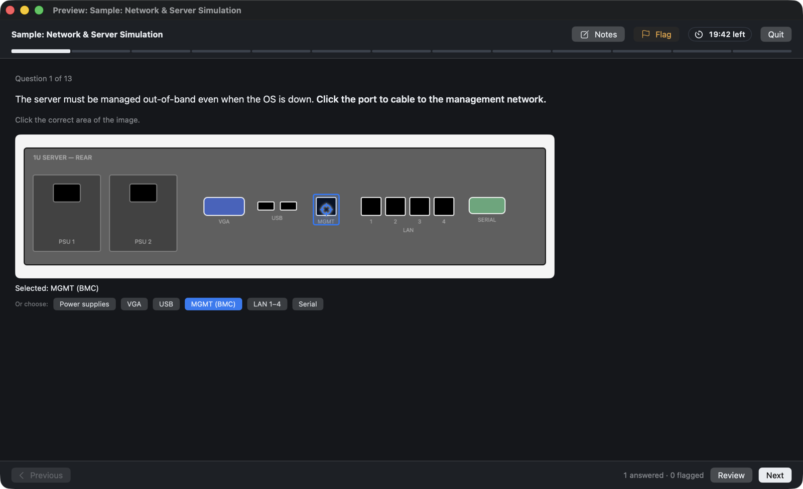
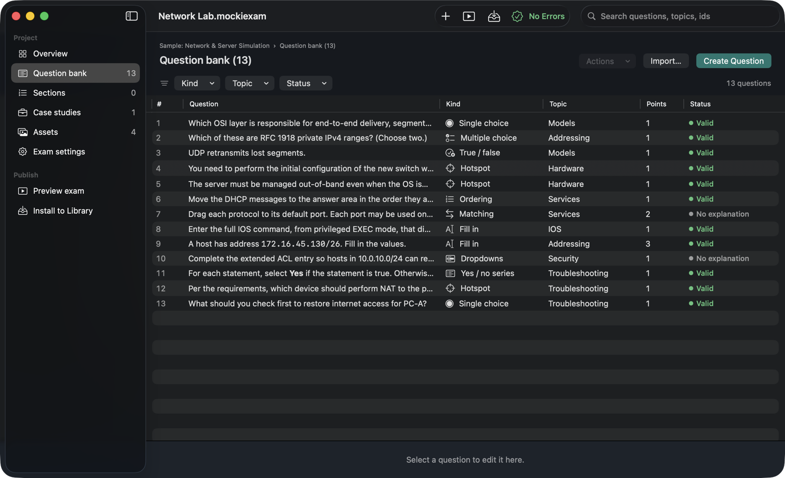
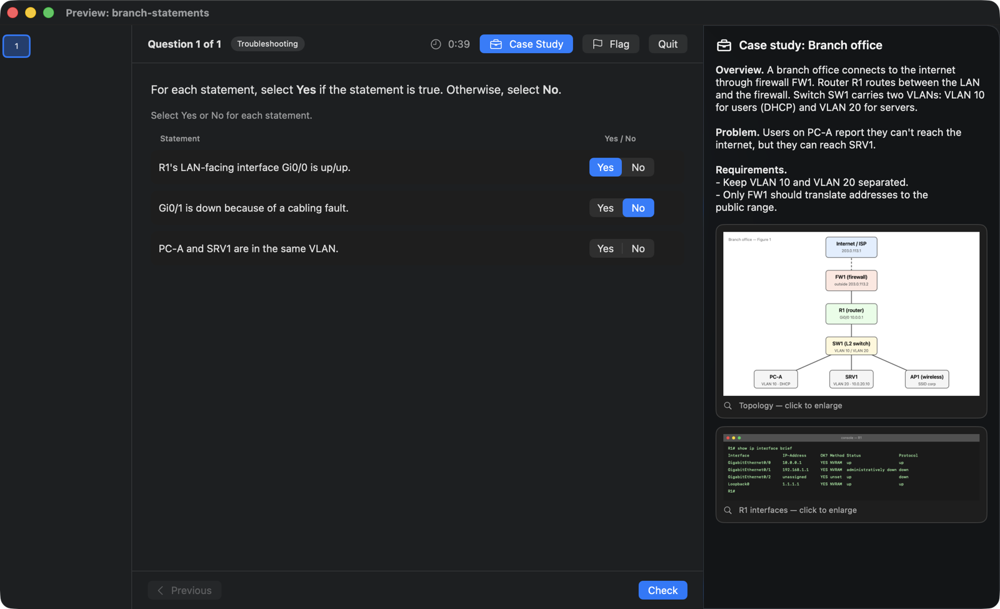
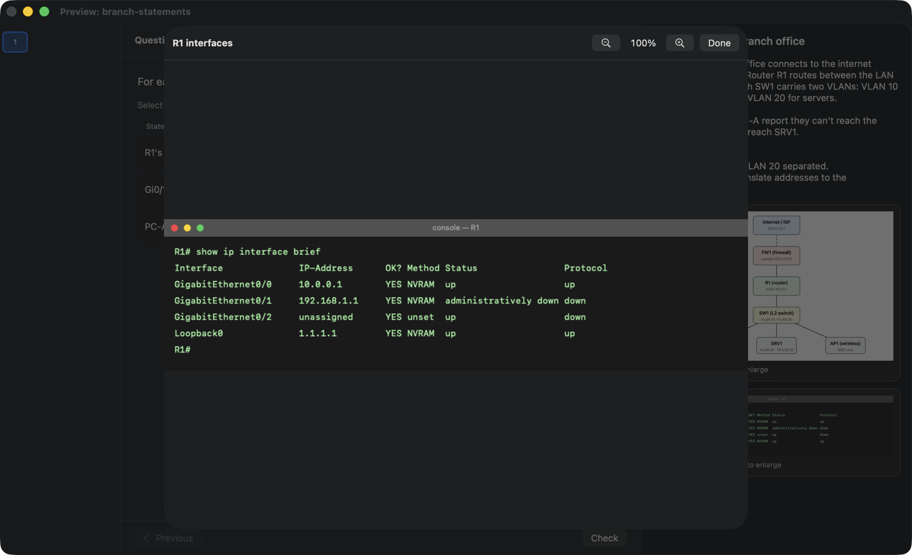

# MockiExams

Practice IT certifications or prepare for any exam with realistic testing simulations and custom tests you can create yourself, on your Mac or PC! Go beyond ordinary practice tests. Experience a realistic exam environment or build your own tests, right from your computer. MockiExams is a free, open-source project.

| Platform | Download | Version |
| :--- | :--- | ---: |
| macOS (Apple silicon and Intel) | [MockiExams-1.0.dmg](https://github.com/lostinthekernel/mockiexams/releases/latest/download/MockiExams-1.0.dmg) | 1.0 |
| Windows x64 | [MockiExams-1.0-Windows-x64-Setup.exe](https://github.com/lostinthekernel/mockiexams/releases/latest/download/MockiExams-1.0-Windows-x64-Setup.exe) | 1.0 |
| Windows ARM64 | [MockiExams-1.0-Windows-arm64-Setup.exe](https://github.com/lostinthekernel/mockiexams/releases/latest/download/MockiExams-1.0-Windows-arm64-Setup.exe) | 1.0 |

> **First launch on macOS:** Open MockiExams > click **Done** > System Settings > Privacy & Security > **Open Anyway**





Need a closer look? Keep case study scenarios and exhibits right beside each question, and open any exhibit to zoom in on the details:





- **Player:** Practice at your own pace with instant feedback, or create a timed exam simulation in a modern or classic testing-center layout. Review your answers: score report and per-topic results.
- **Designer:** Manage exams with a question bank table that supports filters and bulk edits, a step-by-step question builder, hotspot drawing on images, case studies, sections, and blueprint coverage.
- **Nine question kinds:** Choose from single and multiple choice, true/false, yes/no, dropdowns, fill in the blank, matching, ordering, and hotspots.
- **Open format:** Each exam has its own folder containing `exam.json` and its images. See [FORMAT.md](FORMAT.md) for the details.
- **Command line:** `mockiexam` validates, converts (Aiken, Moodle GIFT, CSV), and installs exams.

MockiExams reads only its own open format and does not support encrypted or proprietary files from other exam simulators.

## Requirements

- macOS 15 or later
- Xcode 16 or later
- [XcodeGen](https://github.com/yonaskolb/XcodeGen) (`brew install xcodegen`)

## Build

```sh
xcodegen generate
xcodebuild -scheme MockiExams -configuration Release -destination 'platform=macOS' -derivedDataPath build build
open build/Build/Products/Release/MockiExams.app
```

Or run `xcodegen generate` and open `MockiExams.xcodeproj` in Xcode.

The Windows installers are built with `scripts/build-windows.sh`; see [AGENTS.md](AGENTS.md).

Run the core tests with:

```sh
swift test --package-path Packages/MockiCore
```

## Making exams

```sh
scripts/mockiexam template exam > my-exam/exam.json   # a complete example to edit
scripts/mockiexam convert questions.csv --title "My Practice Exam" -o my-exam/exam.json
scripts/mockiexam validate my-exam/
scripts/mockiexam install my-exam/                    # adds it to the app's library
```

You can also build an exam in the app by selecting File › New, then choosing Install to Library. `samples/` has a small exam that uses every question kind.

Only import questions you have the right to use, such as your own notes, official sample questions, or openly licensed question banks.

## Project layout

Curious about how the project is organized? `AGENTS.md` describes the code layout and the rules for changing the format. Coding agents like Claude Code read it, and it works as a contributor guide too.

## License

MIT. See [LICENSE](LICENSE).
